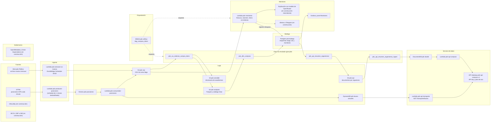
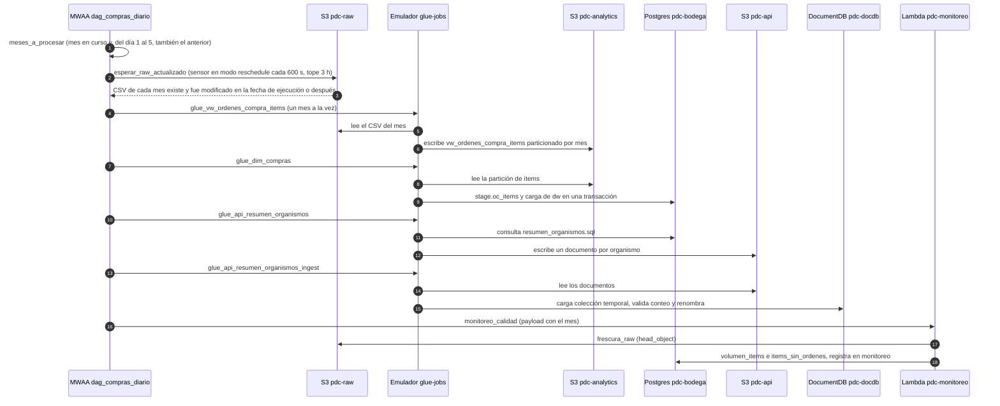

# Plataforma de Datos Chile: recorrido de punta a punta

Este documento explica el proyecto de principio a fin: qué hace cada dominio, cómo viaja un dato desde la fuente hasta el monitoreo, por qué se tomó cada decisión y qué sigue sin estar resuelto.

Todo lo que se afirma sale de los archivos del repo. Las rutas son relativas a la raíz `plataforma-datos-chile/`. El estado corresponde a `spec/TODO.md` y `spec/CHANGELOG.md` al 2026-11-03.

En los diagramas, **(en construcción)** marca lo que `spec/TODO.md` todavía no da por hecho.

---

## 1. Dominios

### Compras públicas (batch)

- **Qué es:** pipeline batch de órdenes de compra de Mercado Público (ChileCompra), con modelo dimensional en Postgres, API de lectura y monitoreo de calidad.
- **Pregunta:** ¿qué organismos concentran sus compras en pocos proveedores o en trato directo, y cómo evoluciona eso en el tiempo?
- **Estado:** fases 2 a 6 cumplidas para julio, agosto y septiembre de 2026. Pendientes: licitaciones, InfoLobby y el endpoint de proveedores.

### Transporte Santiago (tiempo real)

- **Qué es:** ingesta de posiciones GPS de buses del DTPM a través de Kinesis, con estado actual en DynamoDB e historia en S3, más el diccionario DECO en la bodega.
- **Pregunta:** ¿cuánto se desvía el servicio real de buses del programado, por recorrido, sentido y franja horaria?
- **Estado:** el flujo DTPM → Kinesis → Lambda → DynamoDB y S3 → API de buses activos funciona y se probó a mano el 2026-11-03 (el schedule de 1 minuto está creado pero deshabilitado). Las dimensiones de servicio y recorrido vienen del archivo DECO. GTFS y puntualidad están pendientes.

### Economía regional (analítica)

- **Qué es:** dominio planificado con series del Banco Central, CMF e INE, homologación, deflactación y un tablero.
- **Pregunta:** ¿cómo se mueven empleo y precios por región frente al país, y qué regiones se adelantan o se atrasan al ciclo?
- **Estado:** sin código en el repo. Es la fase 8 y no está iniciada.

---

## 2. Diagramas

### 2.1 Plataforma completa

Lectura: la línea de compras va de izquierda a derecha. La línea de transporte (de `DTPM` a `APIT`) funciona de punta a punta, probada a mano; falta la puntualidad, que depende del GTFS. El mismo `RAW` alimenta a la vez el job de ítems y el chequeo de frescura.

### 2.2 Secuencia de `dag_compras_diario`

El DAG corre todos los días a las 09:15 (America/Santiago). Las tareas que dependen de un mes se expanden por mes y corren de a una (`max_active_tis_per_dagrun=1`).

---

## 3. Capas: qué hace, por qué y dónde vive

### 3.1 Ingesta batch (compras)

- **Qué hace:** la Lambda `pdc-extractor-oc-masiva` descarga el ZIP mensual de ChileCompra (`oc-da/AAAA-M.zip`) y lo descomprime en streaming a `s3://pdc-raw/compras/ordenes_compra_masiva/mes=AAAA-MM/AAAA-M.csv`. Corre todos los días a las 09:00 con EventBridge Scheduler (cron en America/Santiago). Los primeros cinco días del mes recarga también el mes anterior. Es idempotente: guarda el ETag de origen en la metadata del objeto (`origen-etag`) y, si no cambió, responde `sin_cambios`.
- **Por qué (ADR-009):** la API entrega por fecha solo código, nombre y estado. El detalle exige una consulta por orden, unas 1.300 al día, que a ritmo seguro toma unos 45 minutos. Eso supera los 15 minutos de una Lambda, consume alrededor del 13% del límite diario del ticket y arriesga respuestas 429 y la suspensión del ticket. El archivo masivo trae todos los ítems y el del mes en curso se actualiza a diario.
- **Alternativas descartadas (ADR-009):** consultar la API orden por orden dentro de una Lambda, y hacer fan-out con SQS a varias Lambdas. La segunda es más rápida, pero multiplica la presión sobre el límite de la API y no hace falta si existe el archivo.
- **Dónde vive:** `dominios/compras/lambdas/extractor_oc_masiva/handler.py` y `plataforma/terraform/extraccion.tf` (timeout de 900 s, 1 GB de memoria, 1 GB de disco efímero). La API queda para consultas puntuales de detalle, con `dominios/compras/scripts/extraer_ordenes_dia.py` (ADR-009).

### 3.2 Lago en capas

| Capa | Dónde | Contenido | Regla y realidad |
|---|---|---|---|
| raw | `s3://pdc-raw/` (`plataforma/terraform/base.tf`) | CSV del masivo por mes. Micro-lotes JSON de posiciones en `transporte/posiciones/` | `ARQUITECTURA.md` dice que raw es inmutable. El extractor sobrescribe el CSV del mes cuando cambia el ETag. Además, la partición del masivo es `mes=AAAA-MM`, no `fecha_carga=YYYY-MM-DD` como dice la tabla de contratos |
| stg | `pdc-stg` (`plataforma/terraform/datos.tf`) | Parquet tipado y deduplicado, según `ARQUITECTURA.md` | Ningún job escribe ahí. El job de ítems lee raw y escribe analytics directamente |
| analytics | `pdc-analytics` (`datos.tf`) | Tabla `vw_ordenes_compra_items`, Parquet con compresión snappy, particionada por `mes` | Registrada en la base `pdc` del catálogo de Glue por `registrar_tabla` en `plataforma/utils/glue_utils.py` |
| sensible | `pdc-sensible` (`datos.tf`) | Diccionario token a RUT y nombre de personas naturales, en `dicc_proveedor_persona_masiva/mes=AAAA-MM/` | Separado del catálogo analítico (ADR-008) |
| api | `pdc-api` (`datos.tf`) | Un documento por organismo y mes, para cargar en DocumentDB | Ver sección 3.5 |

- **Por qué (ADR-008):** minimización. Los datos de contacto del comprador y del proveedor no pasan de raw, y el job de analytics no los selecciona. raw conserva el dato original, así que su acceso debe restringirse (política IAM pendiente en la fase de gobernanza).
- **Dónde vive:** `plataforma/terraform/base.tf` y `plataforma/terraform/datos.tf`.

### 3.3 Glue y seudonimización

- **Qué hace:** los scripts PySpark viven en `dominios/compras/glue/` y usan `GlueContext`. Los cuatro jobs que corre el DAG son:
  - `pdc_vw_ordenes_compra_items`: lee el CSV de raw, tipa montos y fechas, deduplica por ítem, seudonimiza y escribe analytics y el diccionario en sensible.
  - `pdc_dim_compras`: lee la partición de ítems de analytics y carga la bodega.
  - `pdc_api_resumen_organismos`: consulta la bodega y escribe documentos en `pdc-api`.
  - `pdc_api_resumen_organismos_ingest`: carga esos documentos en DocumentDB.
- `dominios/compras/glue/pdc_vw_ordenes_compra.py` es el job anterior, de órdenes desde la API diaria (la muestra de 60 órdenes de la fase 2). No está en el DAG ni en Terraform. Se corre a mano con `plataforma/scripts/glue_local.sh`.
- **Seudonimización (ADR-008):** si el RUT es menor a 50.000.000, el proveedor se marca como persona natural (`es_persona_natural`). Su RUT se reemplaza por `sha2(clave || RUT normalizado, 256)` y su nombre por `PERSONA NATURAL`. La clave viene de Secrets Manager (`pdc/seudonimo`). El diccionario token a RUT se escribe en `pdc-sensible`, fuera del catálogo analítico. La regla por RUT es una heurística documentada: las personas jurídicas suelen tener RUT sobre ese número.
- **Escrituras idempotentes:** cada job purga la partición antes de escribir (`purgar_particion`). `registrar_tabla` crea o actualiza la tabla y la partición en el catálogo.
- **Por qué (ADR-002):** los jobs se escriben como en AWS (GlueContext, DynamicFrame, catálogo) y se ejecutan en la imagen oficial `aws-glue-libs`, apuntada al S3 de floci.
- **Alternativas descartadas (ADR-002):** PySpark puro, que pierde DynamicFrame y el catálogo, y Pandas o DuckDB, que no practican Spark.
- **Dónde vive:** `dominios/compras/glue/*.py`, `plataforma/utils/glue_utils.py` (helpers compartidos: `obtener_secreto`, `sql_token_rut`, `ejecutar_sql` y otros) y `plataforma/terraform/glue_jobs.tf`, que define los jobs, sube scripts y SQL a `s3://pdc-glue-assets` y crea los secretos.

### 3.4 Bodega dimensional

- **Qué hace:** RDS Postgres 16 (`pdc-bodega`, db.t3.micro en Terraform) con esquemas `stage` y `dw`. El modelo es un esquema estrella (`dominios/compras/sql/bodega/01_ddl.sql`):
  - `dim_fecha`: un día por fila, de 2010 a 2030.
  - `dim_organismo` y `dim_unidad_compra`: SCD tipo 1 con MERGE.
  - `dim_proveedor`: SCD tipo 2, solo en `nombre_proveedor`.
  - `fact_orden_compra`: grano de una orden.
  - `fact_orden_compra_item`: grano de un ítem.
- **Carga por mes:** Glue sobrescribe `stage.oc_items` por JDBC. Después, una sola transacción ejecuta `dominios/compras/sql/bodega/02_cargar_compras.sql`: MERGE de dimensiones, SCD tipo 2 del proveedor, DELETE del mes en los hechos e INSERT con claves sustitutas. Si algo falla, `ejecutar_sql` hace rollback.
- **Transporte en la misma bodega:** `dw.dim_servicio` (429 servicios) y `dw.dim_recorrido` (776 recorridos, con sentido I o R) se cargan desde el archivo DECO con `dominios/transporte/scripts/cargar_deco.sh`. El DDL está en `dominios/transporte/sql/bodega/10_ddl_transporte.sql`. La carga es idempotente: una segunda corrida deja los mismos conteos.
- **Por qué Postgres y no Redshift (ADR-003):** floci emula solo el control plane de Redshift y no ejecuta SQL. Postgres permite conservar el patrón de Redshift: escribir a una tabla de stage, borrar el rango y volver a insertar en una transacción. El SQL evita extensiones exclusivas de Postgres cuando hay equivalente en Redshift.
- **Alternativas descartadas (ADR-003):** DuckDB, que no tiene concurrencia de escritura ni el patrón cliente-servidor, y Athena sobre S3 como única capa, que no practica modelado ni cargas transaccionales.
- **Por qué dos tablas de hechos (ADR-010):** los montos de la orden se repiten en cada ítem del archivo. Dejarlos en el hecho de ítems invita a sumarlos varias veces. Cada medida vive en la tabla de su grano.
- **Por qué SCD tipo 2 solo en el nombre (ADR-010):** la primera versión versionaba también actividad y región. En agosto generó 1.205 versiones, casi todas falsas, porque esos atributos vienen por sucursal y truncados. La razón social es el único cambio real.
- **Vigencia (ADR-010):** `vigente_desde` es el primer día del mes cargado, no la fecha de ejecución. Así una carga histórica en un solo día no invierte vigencias.
- **Validación (ADR-010):** julio, agosto y septiembre cuadran con analytics en ítems, órdenes y monto en CLP. Hubo 0 duplicados, 0 huérfanos, 0 proveedores con dos versiones vigentes y 0 vigencias invertidas.
- **Lectura:** el rol `pdc_lector` (`dominios/compras/sql/bodega/03_rol_lector.sql`) tiene solo SELECT sobre `dw` y `monitoreo`. Lo usan el MCP de Postgres y Grafana.
- **Dónde vive:** `plataforma/terraform/bodega.tf`, `dominios/compras/sql/bodega/` y `dominios/transporte/sql/bodega/`.

### 3.5 API de datos

- **Qué hace:** tres pasos antes de servir.
  1. `pdc_api_resumen_organismos` consulta la bodega con `dominios/compras/sql/api/resumen_organismos.sql` y escribe en `s3://pdc-api/resumen_organismos/mes=AAAA-MM/` un documento por organismo, con sus cinco principales proveedores anidados.
  2. `pdc_api_resumen_organismos_ingest` carga los documentos en una colección temporal de DocumentDB, valida que el conteo coincida, crea índices sobre `sector` y `hhi`, y renombra la colección a `resumen_organismos_AAAA_MM` con `renameCollection` y `dropTarget`. Registra el mes en `estado_api`.
  3. La Lambda `pdc-api-compras` lee DocumentDB. El cliente se reutiliza entre invocaciones.
- **API Gateway:** REST `pdc-api-compras`, etapa `v1`. API key obligatoria en cada método, plan de uso de 10 req/s con ráfaga de 20 y cuota de 1.000 requests por día.
- **Endpoints:**
  - `GET /compras/organismos/{codigo}/resumen?mes=AAAA-MM`: monto, órdenes, proveedores, porcentaje en trato directo, porcentaje en compra ágil, HHI y principales proveedores. Sin `mes`, usa el último publicado. Responde 404 si el organismo no tiene datos y 400 si el mes es inválido.
  - `GET /compras/alertas/concentracion?mes&hhi_min=2500&limite=20`: organismos con HHI igual o mayor al umbral. El límite máximo es 100.
- **Indicador HHI (ADR-012):** la suma de los cuadrados de la participación porcentual de cada proveedor en el monto del organismo. 10.000 es un solo proveedor. Por debajo de 1.500 se considera baja concentración y por sobre 2.500, alta.
- **Por qué colección por mes con renombre atómico (ADR-012):** publicar o recargar un mes no toca los demás, y el renombre evita que la API lea una carga a medias.
- **Alternativas:** el ADR-012 no documenta alternativas descartadas.
- **Validación (ADR-012):** con API key responde 200 con datos. Sin key o con una key falsa responde 403. Un organismo inexistente da 404 y un mes inválido da 400.
- **Dónde vive:** `dominios/compras/glue/pdc_api_resumen_organismos.py`, `dominios/compras/glue/pdc_api_resumen_organismos_ingest.py`, `dominios/compras/sql/api/resumen_organismos.sql`, `dominios/compras/lambdas/api_compras/handler.py` y `plataforma/terraform/api.tf`.

### 3.6 Orquestación

- **Qué hace:** MWAA `pdc-airflow` (Airflow 2.10.5, clase mw1.small, en VPC con dos subredes) ejecuta `dag_compras_diario` con schedule `15 9 * * *` en America/Santiago, `catchup` apagado, `max_active_runs=1` y un reintento a los 5 minutos.
- **Orden de tareas:** `meses_a_procesar` → `esperar_raw_actualizado` → `glue_vw_ordenes_compra_items` → `glue_dim_compras` → `glue_api_resumen_organismos` → `glue_api_resumen_organismos_ingest` → `monitoreo_calidad`.
- **Meses:** el mes en curso y, del día 1 al 5, también el anterior. Es el mismo criterio que usa la Lambda extractora.
- **Sensor:** `esperar_raw_actualizado` es un `PythonSensor` en modo reschedule cada 600 segundos, con tope de 3 horas. Espera que el CSV de cada mes exista en raw y haya sido modificado en la fecha de ejecución o después. Así el DAG (09:15) no depende de que la extracción (09:00) termine a una hora fija.
- **Emulación de Glue (ADR-011):** floci guarda los jobs pero no ejecuta `StartJobRun`. El servicio `glue-jobs` (`plataforma/emuladores/glue_jobs/app.py`) atiende `StartJobRun`, `GetJobRun` y `GetJobRuns`. Baja el script y las dependencias desde S3 y lanza el contenedor oficial `aws-glue-libs:5` con `spark-submit`. Cualquier otra operación se reenvía a floci. La conexión `aws_default` vive en Secrets Manager, con `service_config.glue.endpoint_url` apuntando al emulador. El DAG usa `GlueJobOperator` sin cambios. En AWS real basta quitar ese `service_config`.
- **Por qué (ADR-011):** el DAG sigue siendo el que correría en AWS.
- **Alternativas descartadas (ADR-011):** un operador propio que llame a un lanzador (el DAG deja de ser el mismo que correría en AWS) y orquestar solo con Lambdas (la orquestación queda incompleta).
- **Límites del emulador (app.py):** el estado de las ejecuciones vive en memoria y se pierde al reiniciar. El driver usa `MEMORIA_DRIVER` (3g por defecto) y `spark.sql.shuffle.partitions` vale 16. Los workers que declara Terraform (G.1X, 2 workers) el emulador no los lee.
- **Operación:** floci solo copia los DAGs desde S3 al crear el entorno, así que `plataforma/scripts/publicar_dags.sh` sube el archivo y lo copia al contenedor. Después de reiniciar floci, `plataforma/scripts/recrear_mwaa.sh` recrea MWAA. La web de Airflow se expone en `localhost:8080` por el servicio `airflow-ui` (socat), porque floci no expone un puerto estable para la web de MWAA.
- **Dónde vive:** `dominios/compras/dags/dag_compras_diario.py`, `plataforma/terraform/orquestacion.tf`, `plataforma/emuladores/glue_jobs/app.py` y `Dockerfile`, `docker-compose.yml` y los scripts de `plataforma/scripts/`.

### 3.7 Monitoreo

- **Qué hace:** la Lambda `pdc-monitoreo` (Python 3.12, arm64) corre tres chequeos por mes y guarda cada resultado en `monitoreo.chequeos`:
  - `frescura_raw`: el CSV del mes existe en raw y tiene 36 horas o menos.
  - `volumen_items`: los ítems del mes no caen más de un 10% frente a la medición anterior.
  - `items_sin_ordenes`: falla si el mes tiene ítems y ninguna orden.
- Cada falla crea una fila en `monitoreo.alertas` con el mensaje. Si existe `OPENROUTER_API_KEY`, la Lambda pide al modelo `openrouter/free` una explicación de tres frases. Si esa llamada falla, la alerta se guarda sin explicación.
- **Tarea del DAG:** `monitoreo_calidad` es la última del DAG y llama a la Lambda una vez por mes.
- **Visualización:** Grafana 11.3.0 en `docker-compose.yml`, puerto 3000. Tiene un datasource `Bodega` con el rol `pdc_lector` y el panel `Monitoreo`, provisionados desde `plataforma/grafana/`.
- **Por qué (ADR-005):** la alerta no depende del modelo. Si OpenRouter falla o se agota la cuota, la alerta se envía igual, sin explicación. Al modelo no se le envían datos personales, solo metadatos del proceso.
- **Alternativas:** el ADR-005 no documenta alternativas descartadas.
- **Prueba documentada (CHANGELOG, 2026-11-01):** se borró el 20% de los ítems de septiembre (71.110 ítems). `volumen_items` falló (de 355.585 a 284.475) y volvió a `ok` tras restaurar. `frescura_raw` falla de verdad para septiembre porque el archivo tiene más de 34 días.
- **Detalle técnico:** la Lambda se conecta a Postgres con `pg8000`. `scramp` está fijado en 1.4.5 porque `pg8000` 1.31.2 falla con versiones nuevas (CHANGELOG).
- **Dónde vive:** `plataforma/lambdas/monitoreo/handler.py`, `plataforma/sql/monitoreo/01_ddl.sql`, `plataforma/terraform/monitoreo.tf`, `plataforma/grafana/dashboards/monitoreo.json` y `plataforma/grafana/provisioning/datasources/bodega.yml`.

### 3.8 Transporte en tiempo real

- **Fuente (`spec/fuentes/DTPM_Web_Services.md`):** el DTPM entrega posiciones (HTTP Basic, unos 6,4 MB por consulta, se actualiza cada minuto) y alertas. El acceso se otorgó el 2026-10-21. Las credenciales de desarrollo vencen cerca del 2026-12-21, y para producción hay que registrar una IP pública. El servicio funciona sobre HTTP sin TLS, así que las credenciales viajan sin cifrar.
- **Productor (`pdc-productor-posiciones`):** consulta las posiciones, descarta los buses cuya última transmisión GPS (en UTC) tiene más de 5 minutos y publica cada bus en Kinesis `pdc-posiciones`, con la patente como clave de partición, en lotes de 500. Devuelve cuántos registros fallaron. En Terraform corre con `rate(1 minute)`, pero el estado del schedule es `DISABLED`.
- **Consumidor (`pdc-consumidor-posiciones`):** cada lote de Kinesis (tamaño 500, posición inicial LATEST) escribe la última posición de cada patente en DynamoDB `pdc-buses-actuales` (clave `patente`, PAY_PER_REQUEST). También guarda el lote completo en raw como JSON lines en `transporte/posiciones/fecha=AAAA-MM-DD/hora=HH/<request id>.jsonl`.
- **Por qué (spec/dominios/Transporte_Tiempo_Real.md):** separar el estado actual (DynamoDB) de la historia (S3 y bodega). Particionar en Kinesis por patente para mantener el orden dentro de cada shard. Hacer idempotente al consumidor ante reintentos. Ventanas temporales y datos que llegan tarde son conceptos que el dominio quiere practicar.
- **Alternativas:** no hay ADR para transporte. El diseño sale de la nota de dominio.
- **Shortcut declarado en el código:** el consumidor no compara fechas. Gana el último registro del lote por patente. El comentario del código dice que hay que mejorarlo si llegan datos desordenados.
- **Datos del DTPM que hay que tratar:** `fecha_consulta` viene en hora de Chile y las fechas GPS en UTC. Además, la respuesta incluye buses detenidos o con última transmisión antigua (hay casos de 2023), así que hay que filtrar por antigüedad antes de calcular. El 2026-10-21 la consulta traía 13.946 buses y 6.128 transmitieron en los últimos 5 minutos.
- **API (`pdc-api-transporte`):** `GET /transporte/buses?servicio=T502&sentido=I&limite=N` en el mismo API Gateway de compras, con la misma API key. Devuelve los buses activos del servicio con patente, posición, velocidad y hora del GPS, del más reciente al más antiguo. Lee DynamoDB con un scan filtrado (atajo declarado en el código; con ~6.000 buses basta, y a mayor volumen hace falta un índice por servicio).
- **Tipos:** el productor convierte latitud, longitud y velocidad a número y descarta un bus con valores malformados en vez de fallar toda la invocación.
- **Mapa:** `dominios/transporte/scripts/mapa_buses.py` lee DynamoDB y genera una página Leaflet con los buses activos coloreados por velocidad (`docs/capturas/mapa_buses.png`).
- **Prueba del 2026-11-03:** una consulta devolvió 13.980 buses, de los cuales 3.467 estaban activos (era medianoche); 0 fallidos en Kinesis; esos buses quedaron en DynamoDB y en tres micro-lotes de S3. La API respondió 403 sin clave y 200 con clave, y la posición de un bus cambió entre dos consultas.
- **Estado:** el productor consulta solo posiciones, no alertas. El schedule de 1 minuto está creado pero deshabilitado (se activa a mano para no consultar al DTPM sin necesidad). GTFS y puntualidad siguen pendientes: sin horario programado no se puede medir el desvío, que es la pregunta del dominio.
- **Dónde vive:** `dominios/transporte/lambdas/productor_posiciones/handler.py`, `dominios/transporte/lambdas/consumidor_posiciones/handler.py`, `dominios/transporte/lambdas/api_transporte/handler.py`, `plataforma/terraform/transporte.tf`, `dominios/transporte/scripts/cargar_deco.sh`, `dominios/transporte/sql/bodega/10_ddl_transporte.sql` y la documentación oficial en `dominios/transporte/docs/`.

---

## 4. Servicio emulado y servicio real de AWS

Solo aparecen los servicios que usan los `.tf`. El endpoint de todos los servicios apunta a `http://localhost:4566` (`plataforma/terraform/providers.tf`).

| Servicio emulado en floci | Servicio real de AWS | Dónde aparece en los `.tf` | Qué cambia en la emulación |
|---|---|---|---|
| S3 | Amazon S3 | `base.tf`, `datos.tf`, `glue_jobs.tf`, `orquestacion.tf` | Emulado con versionado, multipart y notificaciones (ARQUITECTURA) |
| Lambda | AWS Lambda | `base.tf`, `extraccion.tf`, `api.tf`, `monitoreo.tf`, `transporte.tf` | Real, en contenedores Docker con runtime de AWS (ARQUITECTURA) |
| EventBridge Scheduler | Amazon EventBridge Scheduler | `extraccion.tf`, `transporte.tf` | Programación de EventBridge (ARQUITECTURA) |
| Glue | AWS Glue | `glue_jobs.tf`, `datos.tf` | floci solo emula el catálogo. La ejecución la hace el emulador `glue-jobs` con `aws-glue-libs` (ADR-002, ADR-011) |
| MWAA | Amazon MWAA | `orquestacion.tf` | Airflow real con LocalExecutor (ARQUITECTURA) |
| RDS Postgres | Amazon RDS for PostgreSQL | `bodega.tf` | Real, en Docker (ARQUITECTURA) |
| DocumentDB | Amazon DocumentDB | `api.tf` | Real, compatible con MongoDB (ARQUITECTURA) |
| API Gateway | Amazon API Gateway (REST) | `api.tf` | REST y HTTP v2 (ARQUITECTURA) |
| Secrets Manager | AWS Secrets Manager | `bodega.tf`, `api.tf`, `glue_jobs.tf`, `orquestacion.tf`, `transporte.tf` | Las fuentes del repo no detallan su emulación |
| Kinesis | Amazon Kinesis Data Streams | `transporte.tf` | Streams, shards y fan-out mejorado (ARQUITECTURA) |
| DynamoDB | Amazon DynamoDB | `transporte.tf` | GSI, LSI y streams (ARQUITECTURA) |

Para pasar a AWS real hay que cambiar `providers.tf` y quitar los hosts internos de floci: `HOST_BODEGA` y `HOST_DOCDB` en las Lambdas, `--hostBodega floci` en los jobs y `service_config` en el secreto de Airflow. El repo no documenta una prueba contra AWS real.

---

## 5. Limitaciones conocidas y honestidad técnica

Todo lo de esta sección sale de `spec/TODO.md`, `spec/CHANGELOG.md` o los ADR.

### 5.1 Fallos abiertos

- **Jobs de Glue que mueren por memoria.** Confirmado el 2026-11-03 en las corridas programadas del DAG: el emulador reporta `sin memoria: el proceso fue terminado por el sistema (código 137)` en `glue_vw_ordenes_compra_items`, que a veces pasa y a veces no (en tres corridas seguidas fallaron dos y la del reintento pasó). Docker Desktop tiene 7,65 GB en un Mac de 16 GB; con Airflow (~1,9 GB), floci y el driver de Spark de 3 GB queda al límite. La salida prevista es subir Docker a unos 12 GB; está pendiente de hacer.
- **Mes sin datos al inicio.** Corregido el 2026-11-03: si el CSV del mes nuevo aún no tiene filas, el job de ítems no escribe partición y `pdc_dim_compras` fallaba con `PATH_NOT_FOUND`. Ahora detecta que no hay partición, lo informa y termina en éxito sin cargar nada. Probado con septiembre, que no tiene partición en analytics (la bodega sí tiene septiembre; la capa analytics de ese mes habría que regenerarla).
- **Una ejecución marcada a mano.** La corrida `manual__2026-09-28T18:22:05` se marcó como success desde la interfaz y no procesó datos (TODO).
- **Reintento pendiente.** La corrida fallida del 2026-09-28 sigue sin reintentarse desde la interfaz (TODO).
- **El TODO está desactualizado respecto del código.** El TODO dice que la propuesta de driver de 3 GB, shuffle partitions en 16 y mensaje con el código 137 "no aplicada". En `plataforma/emuladores/glue_jobs/app.py` ya están: `MEMORIA_DRIVER` vale `3g` por defecto, `PARTICIONES_SHUFFLE` vale `16` y hay un mensaje específico para el código 137. Ese mensaje se vio en las corridas del 2026-11-03, así que el código aplicado es el que corre; el TODO es el que está atrasado.

### 5.2 Lo que falta

- **GTFS estático.** No está en el repo ni en el vault. Sin trazados, paraderos y horarios no hay puntualidad (TODO y CHANGELOG).
- **Alertas a Telegram.** Pendientes. Hoy las alertas quedan en `monitoreo.alertas` y en Grafana.
- **Explicación del modelo.** En la prueba del 2026-11-01, la explicación llegó en una de tres alertas, porque el modelo gratuito es intermitente. La Lambda descarta el error (`except Exception` devuelve `None`) y no reintenta. El TODO deja pendiente registrar el error y reintentar una vez.
- **Licitaciones e InfoLobby.** Pendientes (TODO, fase 2). El acceso a InfoLobby figura como "por confirmar" en `spec/fuentes/Fuentes_de_Datos.md`.
- **Endpoint de proveedores.** `/compras/proveedores/{codigo}/ordenes` está pendiente (TODO, fase 5).
- **Backfill desde Airflow.** Pendiente: correr con parámetros desde la interfaz (TODO, fase 4).
- **Dimensión de producto.** Pendiente si el análisis la necesita (TODO, fase 3).
- **MCP de MongoDB.** Pendiente (TODO, fase 1).
- **Economía regional.** Sin código: extracción de BDE, CMF e INE, transformaciones y tablero, todo pendiente (TODO, fase 8). Streamlit, que menciona `ARQUITECTURA.md`, no está. Hoy la única visualización es Grafana, para monitoreo.
- **Gobernanza.** OpenMetadata y Great Expectations no están implementados (ADR-004, TODO fase 6b). Tampoco el linaje ni el glosario.
- **Transporte.** Faltan el GTFS, la puntualidad horaria en Glue y el uso de las alertas del DTPM (TODO fase 7 y código del productor). Tampoco hay un GSI por servicio en DynamoDB: la API usa scan.

### 5.3 Diferencias entre el diseño escrito y el código

- **raw "inmutable" (ARQUITECTURA).** El extractor sobrescribe el CSV del mes cuando cambia el ETag de origen.
- **Partición de raw.** ARQUITECTURA dice `fecha_carga=YYYY-MM-DD`. El masivo usa `mes=AAAA-MM`.
- **stg.** ARQUITECTURA describe Glue, de raw a stg y de stg a analytics. Ningún job escribe en `pdc-stg`.
- **Contexto de la alerta (ADR-005).** El ADR dice que se envía linaje aguas arriba. El handler envía solo el chequeo, el mes y el detalle.
- **Estados de los ADR.** ADR-002 y ADR-005 siguen en "propuesta", aunque su código existe. ADR-006 también figura como "propuesta".
- **Rutas viejas en el CHANGELOG.** Menciona `infra/terraform/`, `airflow/dags/`, `glue/jobs/` y `utils/`. Las rutas actuales son `plataforma/terraform/`, `dominios/compras/dags/`, `dominios/compras/glue/` y `plataforma/utils/`.

### 5.4 Datos y seguridad

- **raw contiene datos de contacto y RUT originales.** Restringir su acceso con IAM está pendiente (ADR-008).
- **Seudonimización.** Es un hash con clave concatenada. HMAC-SHA256 es una mejora pendiente (ADR-008). La regla de persona natural por RUT es una aproximación (ADR-008).
- **Credenciales del DTPM.** Viajan por HTTP sin TLS y vencen cerca del 2026-12-21 (`spec/fuentes/DTPM_Web_Services.md`).
- **Grafana con acceso anónimo y rol Admin** en `docker-compose.yml` (`GF_AUTH_ANONYMOUS_ORG_ROLE=Admin`). El CHANGELOG lo describe como acceso anónimo solo local.
- **Secretos fuera del repo.** `.gitignore` excluye `.env` y `*.tfstate*`.
- **Sin tests automatizados.** El repo no tiene tests. Las validaciones son conteos y pruebas manuales documentadas en el CHANGELOG y en los ADR.

### 5.5 Entorno de desarrollo

- **Glue no corre en AWS dentro de este entorno.** Las ejecuciones viven en el emulador, en memoria. Se pierden al reiniciar (ADR-011).
- **floci no resincroniza DAGs.** Hay que publicarlos con `plataforma/scripts/publicar_dags.sh` (ADR-011).
- **Reiniciar floci deja huérfanos los contenedores de MWAA.** Hay que recrearlos con `plataforma/scripts/recrear_mwaa.sh` (CHANGELOG).
- **Límites de floci en Terraform.** El provider no lee la API key que crea floci, así que la key se crea con `plataforma/scripts/crear_api_key.sh`. El timeout de la integración de API Gateway va con `ignore_changes` (ADR-012).
- **Memoria.** Docker tiene 7,6 GB. OpenMetadata pide al menos 6 GB, por lo que solo se levanta por turnos en sesiones de gobernanza (ADR-004).
- **El repo vive en OneDrive.** Los datos de floci se movieron a `~/.pdc/floci-data`. `empaquetar_lambda.sh` excluye los `.pyc` porque OneDrive daba timeouts al leerlos (CHANGELOG).

---

## 6. Preguntas probables de entrevista

**1. ¿Por qué no extraen las órdenes desde la API de Mercado Público?**
La API entrega por fecha solo código, nombre y estado, y el detalle exige una consulta por orden (unas 1.300 al día). A ritmo seguro eso son unos 45 minutos, más que los 15 de una Lambda, y arriesga respuestas 429 y la suspensión del ticket. Por eso la carga diaria usa el archivo masivo mensual, que trae todos los ítems, y la API queda para consultas puntuales (ADR-009).

**2. ¿Por qué Postgres como bodega si el enfoque es Redshift?**
floci solo emula el control plane de Redshift y no ejecuta SQL, así que no había cómo practicar la carga. Postgres permite conservar el patrón de Redshift: tabla de stage, borrado del rango e inserción en una transacción. Lo que no se practica son distkey, sortkey y COPY desde S3, y queda documentado como diferencia (ADR-003).

**3. ¿Cómo garantizan que una recarga no duplique datos?**
Cada job purga la partición antes de escribir y la bodega borra el mes en los hechos antes de insertarlo, todo en una transacción con rollback si falla. La extracción omite la descarga si el ETag de origen no cambió. En las pruebas, volver a correr el DAG dejó los conteos sin cambios (CHANGELOG, ADR-010).

**4. ¿Qué hacen con los datos personales de las órdenes?**
Minimizan: los datos de contacto no pasan de raw. Seudonimizan el RUT de las personas naturales con un hash sobre la clave secreta y el RUT normalizado, y guardan el diccionario de tokens en un bucket separado (`pdc-sensible`). La clave viene de Secrets Manager. La regla de persona natural (RUT menor a 50.000.000) es una heurística documentada, y el HMAC queda como mejora pendiente (ADR-008).

**5. ¿Por qué SCD tipo 2 solo para el nombre del proveedor?**
La primera versión versionaba también actividad y región, y en agosto generó 1.205 versiones, casi todas falsas, porque esos atributos vienen por sucursal y truncados. Solo la razón social cambia de verdad. La vigencia usa el primer día del mes cargado, no la fecha de ejecución, para que una carga histórica no invierta las vigencias (ADR-010).

**6. ¿Cómo orquestan jobs de Glue si floci no los ejecuta?**
Un servicio emulador (`glue-jobs`) atiende `StartJobRun` y `GetJobRun`. Baja el script desde S3 y lanza el contenedor oficial `aws-glue-libs:5` con `spark-submit`. El DAG usa `GlueJobOperator` sin cambios, y en AWS real basta quitar el `service_config` de la conexión. La limitación es que el estado de las ejecuciones vive en memoria (ADR-011).

**7. ¿Cómo está diseñado el DAG diario?**
Corre a las 09:15 y un sensor espera a que el CSV de cada mes exista en raw y haya sido modificado en la fecha de ejecución. Después corren en orden los jobs de ítems, bodega, API e ingesta a DocumentDB, cada uno por mes y de a uno, y al final el monitoreo. `max_active_runs=1` evita dos corridas a la vez, y cada job es idempotente, así que reintentar una tarea no duplica datos.

**8. ¿Cómo protegen la API y qué significa el HHI?**
API Gateway exige API key en cada endpoint y tiene un plan de 10 req/s con ráfaga de 20 y 1.000 requests por día. Sin key responde 403. El HHI es la suma de los cuadrados de la participación de cada proveedor en el monto del organismo: 10.000 es un solo proveedor, bajo 1.500 es baja concentración y sobre 2.500 es alta. Cada mes se publica en su propia colección con renombre atómico, así la API nunca lee una carga a medias (ADR-012).

**9. ¿Cómo maneja el estado actual de los buses?**
El consumidor escribe la última posición de cada patente en DynamoDB, y guarda el lote completo como JSON lines en S3 para la historia. Kinesis particiona por patente, así que los registros de un bus se mantienen en orden dentro de un shard. El shortcut declarado no compara fechas, así que un lote desordenado puede dejar un registro viejo, y el productor todavía tiene el schedule deshabilitado.

**10. ¿Cuál es el punto más frágil hoy?**
Los jobs de ítems de Glue mueren por memoria (código 137, confirmado en las corridas del DAG) porque Docker tiene 7,65 GB y entre Airflow, floci y el driver de Spark queda al límite; a veces pasa y a veces no, y el reintento automático lo tapa. La solución es subir Docker a unos 12 GB, y está pendiente. Además, una corrida de septiembre se marcó como success a mano sin procesar datos, y las alertas solo quedan en la base y en Grafana, porque Telegram no está hecho.
